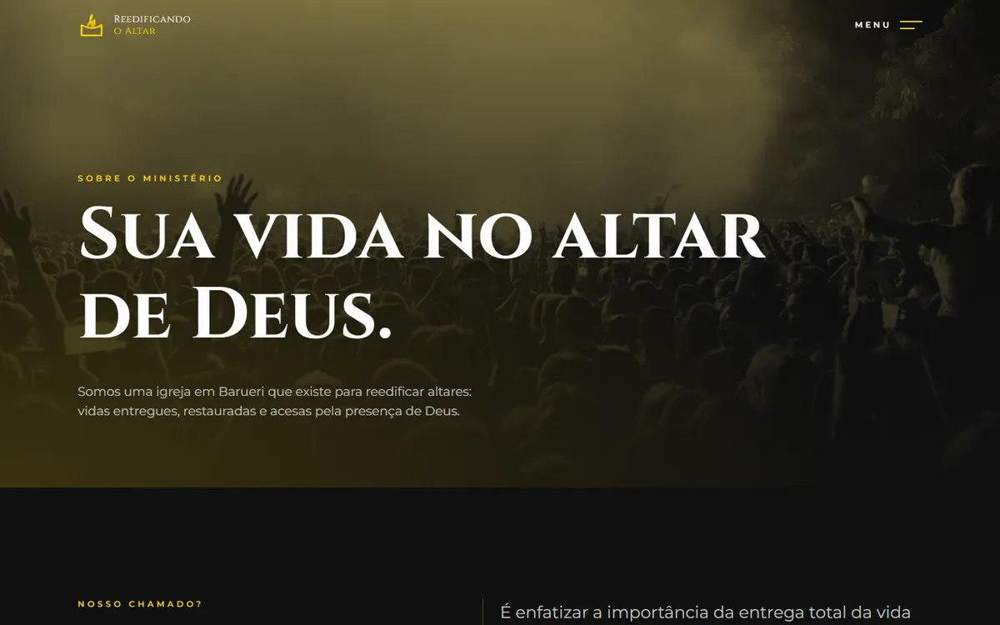
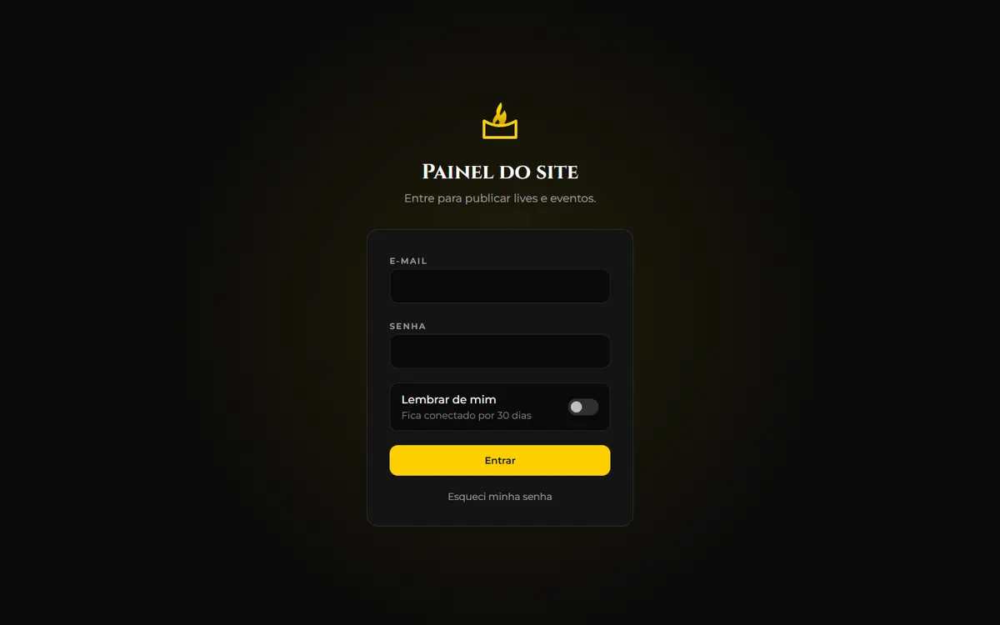

<div align="center">


# Ministério Reedificando o Altar

Site, painel administrativo e API de uma igreja em Barueri/SP, do design ao servidor.

**[reedificandooaltar.com.br](https://reedificandooaltar.com.br)**


</div>

## Sobre o projeto

A igreja tinha um site antigo em PHP, sem painel, difícil de atualizar e com problemas de segurança. Este projeto substitui tudo:

- um **site público** rápido, bonito e bem posicionado no Google;
- um **painel** para a liderança publicar lives, eventos e textos sem depender de programador;
- uma **API** própria, com autenticação e proteções de verdade;
- a **migração** dos dados e dos logins do site antigo, sem ninguém precisar trocar de senha.

Fiz o projeto sozinho, de ponta a ponta: interface, animações, back-end, banco de dados, segurança, publicação na Hostinger e a migração.

## Destaques

### O altar das 12 pedras

A página inicial conta a história de 1 Reis 18: conforme a pessoa rola a página, as doze pedras se juntam e o altar é reconstruído, até o fogo acender.

- No computador, a cena é em **3D** (Three.js com React Three Fiber), sincronizada com a rolagem pelo GSAP.
- Celulares e tablets recebem uma **versão 2D** com o mesmo roteiro, para não pesar no aparelho.
- A versão 2D também vai para quem pediu menos movimento no sistema (`prefers-reduced-motion`), para aparelhos com pouca memória ou sem WebGL 2 e para conexões lentas ou com economia de dados.

<table>
  <tr>
    <td width="72%"></td>
    <td width="28%"></td>
  </tr>
</table>

### Desempenho

- Cada página pública é **pré-gerada em HTML** no build. O Google lê o conteúdo completo, e a página aparece antes do JavaScript carregar.
- CSS crítico embutido no HTML, fontes servidas pelo próprio site e imagens em WebP com versões menores para telas pequenas.
- O mapa e a cena 3D só carregam quando são necessários.
- **Lighthouse no celular:** de 89 a 91 na página inicial e de 85 a 89 nas outras. No computador, de 86 a 97.

### Segurança

| Ameaça | Proteção |
| --- | --- |
| Roubo de sessão | JWT em cookie `httpOnly`, `Secure` e `SameSite` |
| CSRF | Token em cookie duplo, conferido em toda requisição que altera dados |
| Senhas vazadas | Argon2id. As senhas bcrypt do site antigo são convertidas no primeiro login |
| Força bruta | Limite de tentativas por e-mail e por IP (IPv6 agrupado por /64), com resposta de mesmo tempo para e-mail existente ou não |
| SQL injection | Prepared statements nativos em todas as consultas, sem emulação |
| XSS e injeção de cabeçalhos | Entrada validada e limpa no servidor, saída escapada, e CSP, HSTS e Permissions-Policy no `.htaccess` |
| Spam nos formulários | Campo-armadilha, limite de envios e suporte ao Cloudflare Turnstile |
| Sessões antigas | Trocar a senha encerra todas as sessões abertas |
| Uploads | Só imagens, convertidas para WebP no servidor e com limite de tamanho |

### Painel administrativo

Administradores veem tudo. Editores veem só o painel inicial, as lives e a agenda.

| Tela | O que faz |
| --- | --- |
| Lives | Colar o link do YouTube já preenche o título e a capa. Liga e desliga o selo "Ao vivo" |
| Agenda | Calendário com arrastar e soltar e eventos semanais ou mensais |
| Mensagens | Pedidos de oração e contatos, com filtro, marcar como lida e responder |
| Conteúdo | Horários, endereço, redes sociais, textos, líderes e a linha do tempo da igreja |
| Usuários | Contas com papéis de admin e editor |

<table>
  <tr>
    <td width="50%"></td>
    <td width="50%"></td>
  </tr>
  <tr>
    <td colspan="2"></td>
  </tr>
</table>

## Tecnologias

| Parte | Tecnologias |
| --- | --- |
| Site e painel | React 19, TypeScript, Vite, Tailwind CSS 4, TanStack Query, React Router |
| Animação e 3D | Three.js, React Three Fiber, GSAP com ScrollTrigger, Motion, Lenis |
| API | PHP 8.2+, Slim 4, PDO, PHPMailer, firebase/php-jwt |
| Banco | MySQL em produção e SQLite em desenvolvimento |
| Hospedagem | Hostinger (LiteSpeed com CDN), publicada por um pacote gerado com um comando |

## Estrutura

```
frontend/
  scripts/prerender.mjs   gera o HTML de cada página pública depois do build
  src/
    app/                  rotas e layout geral
    pages/                site público, uma pasta por página
    admin/                painel /admin, carregado só por quem entra nele
    components/altar/     a cena das 12 pedras (3D, 2D e o roteiro compartilhado)
    lib/                  cliente da API, tipos, consultas, datas e SEO
api/
  bin/                    criação do banco e migração do site antigo
  config/                 rotas e configurações
  src/
    Controllers/          uma classe por recurso da API
    Middleware/           CORS, login e CSRF, somente JSON, cabeçalhos de segurança e erros
    Repositories/         todo o acesso ao banco
    Services/             sessão, senhas, e-mail, uploads e limites de tentativas
scripts/pacote.mjs        monta o site-novo.zip para publicar
```

## Rodar localmente

Pré-requisitos: Node 20+, PHP 8.2+ (com as extensões `gd` e `sodium`) e Composer.

```bash
cp .env.example .env
```

No `.env`, use `DB_DRIVER=sqlite` para não precisar de MySQL, e gere um `JWT_SECRET` com `php -r "echo bin2hex(random_bytes(48));"`.

```bash
cd api
composer install
php -d extension=gd -d extension=sodium bin/setup-db.php --seed --exemplos --admin-email=voce@exemplo.com --admin-nome="Seu Nome"
composer serve
```

Em outro terminal:

```bash
cd frontend
npm install
npm run dev
```

Abra http://localhost:5173. Para ver as duas versões do altar, use `?altar=full` (3D) ou `?altar=lite` (2D).

As fotos dos líderes não estão no repositório. Em um clone, essas imagens aparecem vazias até serem enviadas pelo painel.

## Publicação

`npm run pacote`, na raiz, gera o `site-novo.zip` com a API e o site prontos para a Hostinger. O passo a passo completo, com as variáveis do `.env`, está em [docs/publicacao.md](docs/publicacao.md).

## Licença

[MIT](LICENSE). Se a sua igreja quiser usar este projeto como base, fique à vontade.
